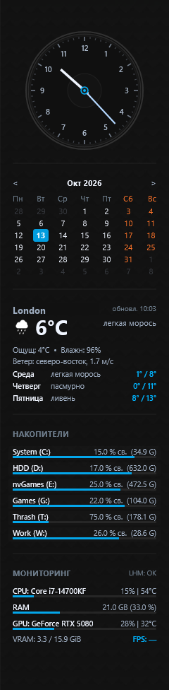

# Darksidebar-11 (Русская документация)

<p align="center">
  
</p>

<p align="center">
  <b>Современная, аппаратно-ускоренная многофункциональная боковая панель для Rainmeter в Windows 11.</b>
</p>

<p align="center">
  <a href="https://github.com/Anilexis/Darksidebar-11/releases/latest"></a>
  <a href="LICENSE"></a>
  <a href="https://www.rainmeter.net/"></a>
  
</p>

---

<p align="center">
  <a href="README.md">English Version</a> • <b>Русская версия</b>
</p>

---

## 🚀 Возможности

- **🎨 Эстетика Dark Glass в стиле Windows 11:** Компактная ширина 240px, полупрозрачный темный фон (`#121212`, 86%), тонкая рамка 1px, премиальная швейцарская типографика и выверенные вертикальные ритмы.
- **🕒 Высокоточные аналоговые часы:** Плавные стрелки с настраиваемой толщиной, секундная стрелка и цифровая дата.
- **📅 Интерактивный календарь:** Сетка месяца (Пн/Вс первый день), индикатор сегодняшней даты, переключение месяцев, праздничные дни и запуск приложения календаря.
- **⛅ Погода Open-Meteo:** Текущие метеоданные и прогноз на 3 дня через бесплатный Open-Meteo API (без API-ключей), автоопределение города по IP при первом запуске, поиск любого города и переключение °C / °F.
- **💾 Динамический монитор накопителей:** Автоматическое обнаружение всех локальных дисков ПК (C:, D:, и т.д.), отображение свободного места и полосы заполнения. Клик по строке открывает корень диска в Проводнике.
- **⚡ Нулевая нагрузка на процессор (0.00% CPU):** Собственный NativeAOT in-process плагин (`NvBridge.dll`) на C# .NET 8. Считывает температуру CPU Package, загрузку GPU, температуру GPU Core, видеопамять VRAM через NVML и FPS активной игры без LibreHardwareMonitor и RTSS.
- **🖥️ Интеллектуальная привязка к монитору:** Закрепление за конкретным монитором по аппаратному PnP ID с учетом границ рабочей области и панели задач.
- **⚙️ Встроенное окно настроек (GUI):** Интерактивная панель параметров (кнопка шестеренки или клик правой кнопкой мыши) для управления мониторами, погодой, единицами измерения, языком и ярлыками.

---

## 📦 Установка

### Вариант 1: Установка в 1 клик (.rmskin) — Рекомендуется

1. Скачайте свежий релиз **`Darksidebar-11-v1.0.0.rmskin`** со страницы [GitHub Releases](https://github.com/Anilexis/Darksidebar-11/releases/latest).
2. Дважды кликните по скачанному файлу.
3. В открывшемся стандартном установщике Rainmeter нажмите **Install**.
4. Панель сразу появится на вашем рабочем столе!

> **Требование:** На вашем ПК должен быть установлен [Rainmeter](https://www.rainmeter.net/) версии 4.5.18 или выше.

---

### Вариант 2: Пакетный менеджер Scoop

Если вы используете [Scoop](https://scoop.sh/), вы можете установить и обновлять Darksidebar-11 из командной строки:

```powershell
# 1. Подключение бакета Darksidebar-11
scoop bucket add darksidebar https://github.com/Anilexis/Darksidebar-11

# 2. Установка скина
scoop install darksidebar-11

# 3. Обновление до новой версии в будущем
scoop update darksidebar-11
```

---

## ⚙️ Настройка панели

Нажмите на иконку **шестеренки** в правом верхнем углу панели или выберите пункт в контекстном меню:

- **Целевой монитор:** Выбор экрана для вывода (Основной, Дополнительный).
- **Расположение:** Привязка к правому или левому краю экрана.
- **Погода и город:** Поиск любого города мира или кнопка *Автоопределение города по IP*.
- **Единицы измерения:** Переключение шкалы температуры (°C / °F).
- **Календарь и часы:** Выбор первого дня недели (Понедельник / Воскресенье), толщина стрелок часов (Тонкие, Нормальные, Толстые).
- **Запуск программ:** Привязка стороннего календаря и погодного приложения при клике.
- **Язык интерфейса:** Мгновенное переключение между русским и английским языками.

---

## 🛠️ Сборка из исходников

Для самостоятельной компиляции плагина NativeAOT и сборки пакета `.rmskin`:

1. Клонируйте репозиторий:
   ```powershell
   git clone https://github.com/Anilexis/Darksidebar-11.git
   cd Darksidebar-11
   ```
2. Запустите сборщик:
   ```powershell
   .\build-package.ps1 -Version "1.0.0" -RebuildPlugin
   ```
   Готовый пакет `.rmskin` будет помещен в папку `dist/`.

---

## 📄 Лицензия

Распространяется под свободной лицензией [MIT License](LICENSE).
